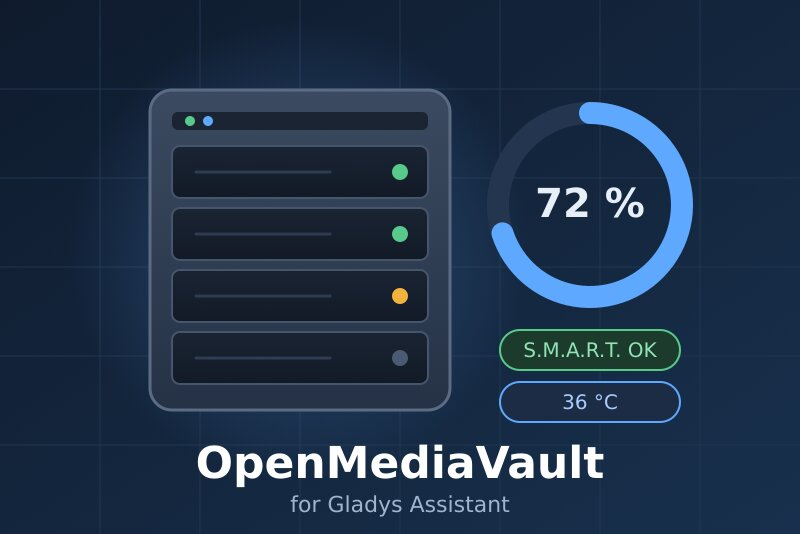
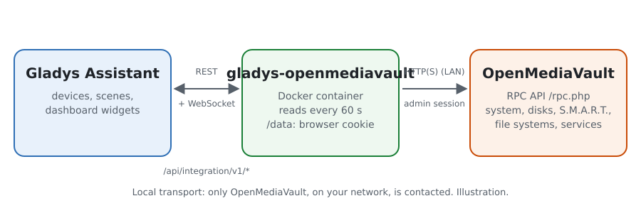
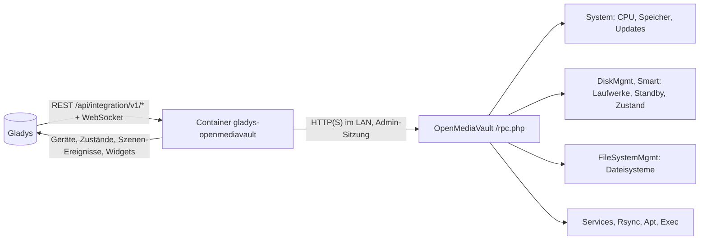
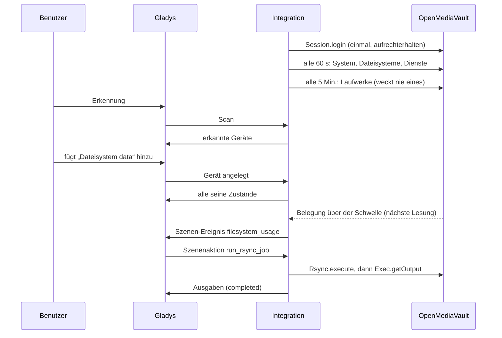
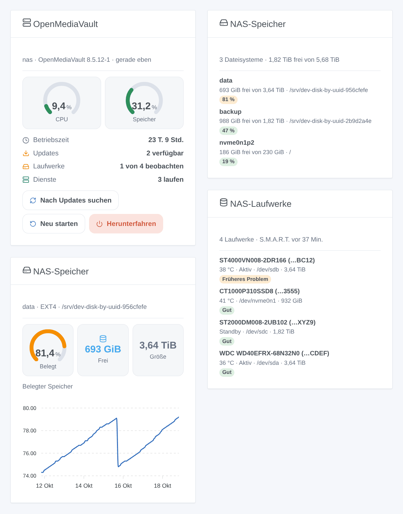

# Gladys OpenMediaVault

[English](README.md) · [Français](README.fr.md) · **Deutsch** · [Español](README.es.md)

[](LICENSE)
[](https://github.com/William-De71/gladys-openmediavault/releases)
[](https://github.com/William-De71/gladys-openmediavault/actions/workflows/release.yml)
[](https://gladysassistant.com)



Externe Integration von [Gladys Assistant](https://gladysassistant.com) für das NAS **OpenMediaVault**: CPU, Speicher und Updates, Temperatur, Standby und S.M.A.R.T.-Zustand der Laufwerke, Belegung der Dateisysteme, Dienste und rsync-Aufträge, mit Szenen und Dashboard-Widgets. Alles läuft über die Weboberfläche von OpenMediaVault in Ihrem lokalen Netzwerk: keine Cloud.

Benutzerdokumentation: [English](docs/en.md) · [Français](docs/fr.md) · [Deutsch](docs/de.md) · [Español](docs/es.md).

> Community-Integration, weder mit dem openmediavault-Projekt verbunden noch von ihm unterstützt.

## Funktionen

- **NAS**-Gerät: CPU- und Speicherauslastung, Betriebszeit, zu aktualisierende Pakete, Version.
- Ein Gerät pro **Laufwerk** (Temperatur, Standby, S.M.A.R.T.-Zustand), pro **Dateisystem** (belegter und freier Speicher) und pro aktiviertem **Dienst** (läuft oder nicht).
- **Laufwerke im Standby werden standardmäßig nie geweckt**: Der S.M.A.R.T.-Zustand wird nur gelesen, wenn alle Laufwerke laufen.
- **8 Szenen-Auslöser**, **5 Szenenaktionen** (rsync-Auftrag, Update-Suche, Neustart, Herunterfahren…) und **3 Dashboard-Widgets** (unten).
- Getestet mit einem echten OpenMediaVault 8.5.
- Überall vier Sprachen: Englisch, Französisch, Deutsch, Spanisch.

## Funktionsweise





Von der Erkennung zur Szene:



### Transport

`transports: ["local"]`: Die Integration spricht nur mit der Weboberfläche von OpenMediaVault in Ihrem Netzwerk, mit denselben RPC-Aufrufen wie Ihr Browser. Das HTTPS-Zertifikat wird nur geprüft, wenn Sie „HTTPS-Zertifikat prüfen“ ankreuzen. Keine Daten verlassen Ihr Netzwerk; OpenMediaVault kontaktiert bei einer Update-Suche selbst seine Paketquellen.

## Geräte und Funktionen

| Gerät       | Funktionen (Kategorie / Typ)                                                                                    |
| ----------- | --------------------------------------------------------------------------------------------------------------- |
| NAS         | CPU, Speicher (`level-sensor` %), Betriebszeit (`duration`, Tage), Updates (`counter-sensor`), Version (`text`) |
| Laufwerk    | Temperatur (`device-temperature-sensor` °C), Energiezustand und S.M.A.R.T.-Zustand (`text`)                     |
| Dateisystem | Belegter Speicher (`level-sensor` %), freier Speicher (`data` / `size`, GB)                                     |
| Dienst      | Läuft (`switch` / `binary`, nur lesend: ein Abzeichen Aktiv / Inaktiv)                                          |

Die externen IDs beruhen auf stabilen Kennungen: der Seriennummer eines Laufwerks (sonst seinem WWN, nie `/dev/sdX`), der UUID eines Dateisystems, dem Namen eines Dienstes. Jede Funktion ist ein Zustand: Die Befehle sind Szenenaktionen.

## Szenen-Auslöser, -Aktionen und Widgets



**Widgets**: OpenMediaVault (Anzeigen für CPU und Speicher, Betriebszeit, Updates, Laufwerke, Dienste; Tasten „Nach Updates suchen“, „Neu starten“ und „Herunterfahren“, die beiden letzten mit Bestätigung), NAS-Speicher (alle Dateisysteme oder eines mit dem Verlauf seiner Belegung), NAS-Laufwerke (Temperatur, Standby, Zustand).

**Auslöser**: NAS nicht erreichbar oder zurück (zwei Lesungen ohne Antwort), NAS neu gestartet, Updates verfügbar, Neustart erforderlich, Laufwerkszustand geändert, Dateisystem über oder unter seiner Warnschwelle (der in OpenMediaVault eingestellten), Dateisystem fehlt oder zurück, Dienst gestartet oder beendet.

**Aktionen**: Status lesen, rsync-Auftrag starten (wartet bis zu 100 s und liefert `completed`, `failed` oder `running`), nach Updates suchen (`apt update`, installiert nichts), neu starten, herunterfahren (mit optionaler Verzögerung).

Beispiele:

- Wenn ein Laufwerk fehlerhaft wird → die Zusammenfassung des Ereignisses per Telegram schicken.
- Jede Nacht um 2 Uhr → den rsync-Auftrag „Fotosicherung“ starten; wenn `status` nicht `completed` ist, mich benachrichtigen.
- Wenn das Haus eine Woche leer ist → das NAS herunterfahren.

Ein von Gladys verlangter Neustart oder ein Herunterfahren löst weder „nicht erreichbar“ noch „neu gestartet“ aus; eine von einer Szene gestartete Update-Suche löst nie „Updates verfügbar“ aus.

## Voraussetzungen

- Gladys Assistant **5.3.0** oder neuer (Widgets und Szenen, Katalog-Suchbegriffe von Gladys 5.3): Ältere Instanzen können die Integration nicht installieren.
- OpenMediaVault 7 oder 8 (OpenMediaVault 6 ohne Standby der Laufwerke) und ein Administratorkonto ohne Zwei-Faktor-Anmeldung (siehe [Dokumentation](docs/de.md#voraussetzungen)).

## Installation

- **Aus dem Store**: Integrationen → OpenMediaVault → Installieren.
- **Über die URL des Repositorys**: Integrationen → externe Integration → `https://github.com/William-De71/gladys-openmediavault`.
- **Entwicklermodus**: `npm start` mit den von Gladys gelieferten Variablen starten (siehe Entwicklung).

## Konfiguration

| Feld                             | Standard              | Bedeutung                                                      |
| -------------------------------- | --------------------- | -------------------------------------------------------------- |
| Adresse von OpenMediaVault       | —                     | `http://192.168.1.10`, mit Port, wenn er nicht 80 oder 443 ist |
| Benutzer / Passwort              | `admin` / —           | Ein Administrator (das Passwort ist ein `secret`-Feld)         |
| HTTPS-Zertifikat prüfen          | aus                   | Nur für eine `https://`-Adresse mit gültigem Zertifikat        |
| Leseintervall                    | 60 s                  | 15 bis 240 s; die Laufwerke alle 5 Min.                        |
| S.M.A.R.T.-Zustand der Laufwerke | kein Laufwerk schläft | wenn kein Laufwerk im Standby ist, stündlich, nie              |
| Sprache der Texte                | automatisch           | Namen, Zustände und Szenen-Zusammenfassungen                   |

## Verwendung

1. Konfiguration ausfüllen, dann auf **Verbindung testen** klicken.
2. **Erkennung**, dann das NAS, die Laufwerke, Dateisysteme und Dienste hinzufügen, die Sie möchten.
3. Die Widgets einem Dashboard hinzufügen und Szenen mit den Auslösern und Aktionen bauen.

## Entwicklung

```bash
npm install
npm test                       # node --test, nie mit dem Netzwerk
npm run lint                   # ESLint
npm run format:check           # Prettier
npx github:GladysAssistant/integration-store . --skip-image-check
scripts/build-cover.sh         # cover.jpg aus docs/assets/cover.svg
docs/illustrations/render.sh   # docs/assets/widgets.<lang>.png
```

Lokal liest das SDK `GLADYS_HOST_API_URL`, `GLADYS_INTEGRATION_TOKEN` und `GLADYS_INTEGRATION_SELECTOR` (von Gladys im Entwicklermodus geliefert). `DEBUG=gladys-integration-sdk` zeigt die Protokolle des SDK.

Die Tests decken den RPC-Client ab (Sitzungen, Cookies, Fehler, den echten Transport auf einem lokalen Server), das Lesen der Antworten (an einem echten OpenMediaVault 8.5 aufgezeichnet, dann anonymisiert), die Übergänge, die Geräte (die Felder, die der Erkennungsbildschirm verlangt), die Widgets (`validateWidgetContent`), die Szenen-Ereignisse und -Ausgaben, das Manifest, die vier Sprachen, das Release-Skript und die ganze Integration gegen das Fake-Gladys des SDK und ein Fake-OpenMediaVault. `test/structure.test.js` friert jeden bei den Benutzern gespeicherten Schlüssel ein.

## Release-Prozess


Jeder Merge auf `main` startet die CI und berechnet dann die Version aus den [Conventional Commits](https://www.conventionalcommits.org/de/) seit dem letzten Tag: `feat` → Minor, `fix` / `perf` → Patch, `!` oder `BREAKING CHANGE` → Major (ein Minor vor 1.0.0); `docs`, `chore`, `ci`, `test`, `style`, `refactor`, `build` allein veröffentlichen nichts. Der Changelog-Abschnitt wird erzeugt, der Tag gepusht, das Multi-Architektur-Image gebaut, dann erhält `main` den Release-Commit, die GitHub Release wird erstellt und ein letzter Job prüft das öffentliche Image, den Store-Validator und das Topic.

- Der Titel des Pull Requests wird zum Squash-Commit und dann zur Changelog-Zeile: auf Englisch und für den Benutzer schreiben (`pr-title.yml` prüft es). `CHANGELOG.md` nie von Hand bearbeiten.
- 1.0.0 ist eine Entscheidung: Actions → Release → Run workflow mit `release-as: 1.0.0`. `dry-run` zeigt Version und Notizen, ohne etwas zu veröffentlichen.
- **Geschützter Branch**: Die Release pusht ihren Commit mit `GITHUB_TOKEN` auf `main`. Das Ruleset `protect-main` (kein Löschen, kein Force-Push) lässt ihn durch; eine strengere Regel (Pull Request Pflicht, Status-Checks) verlangt, GitHub Actions in ihre Ausnahmeliste aufzunehmen, oder eine GitHub App.
- Nach der ersten Release das `ghcr.io`-Paket öffentlich machen (Package settings → Change visibility), sonst kann Gladys es nicht laden.

## Fehlerbehebung

Siehe [docs/de.md](docs/de.md#fehlerbehebung). Probleme bitte mit den Versionen von Gladys, der Integration und von OpenMediaVault sowie den Protokollen (`DEBUG=gladys-integration-sdk`) melden.

## Mitwirken

Issues und Pull Requests sind willkommen. Vor einem Pull Request `npm run format:check && npm run lint && npm test` ausführen und jede externe ID und jeden gespeicherten Schlüssel unverändert lassen (siehe [CLAUDE.md](CLAUDE.md)).

## Sicherheit

Siehe [SECURITY.md](SECURITY.md): Schwachstellen bitte vertraulich melden. Das Passwort ist ein `secret`-Feld, wird nie protokolliert und nie in eine URL gesetzt; nur das Cookie „bekannter Browser“ von OpenMediaVault wird in `/data` behalten, nie die Sitzung. OpenMediaVault hat keine Nur-Lese-Rolle: Nutzen Sie ein eigenes Administratorkonto für Gladys.

## Kommende Screenshots

Die Bilder oben sind Illustrationen, keine Screenshots. Echte Screenshots kommen nach `docs/assets/screenshots/` (PNG, 1280 × 800): `configuration.png`, `discovery.png`, `devices.png`, `scene.png`.

## Lizenz

[Apache License 2.0](LICENSE) — siehe auch [NOTICE](NOTICE). Diese Community-Integration ist nicht mit dem openmediavault-Projekt verbunden. Dank an die Dokumentation und das SDK von Gladys, an den Quellcode von openmediavault und an homeassistant-openmediavault für die Inspiration.
