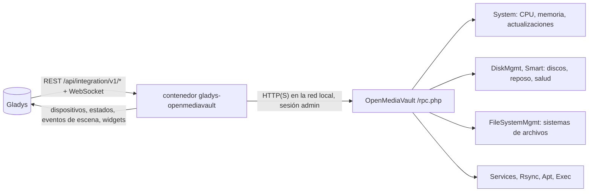
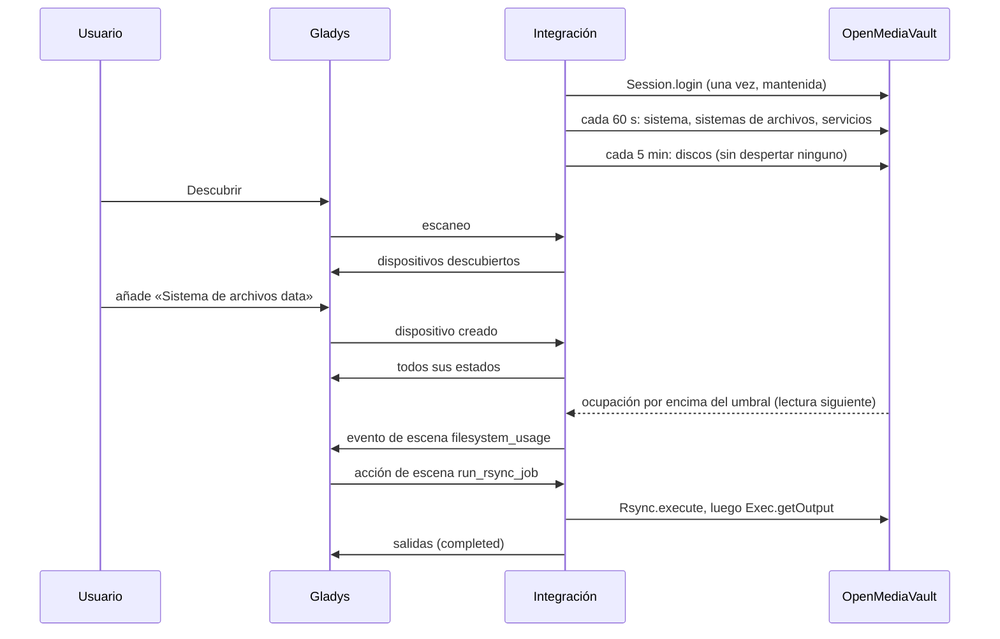
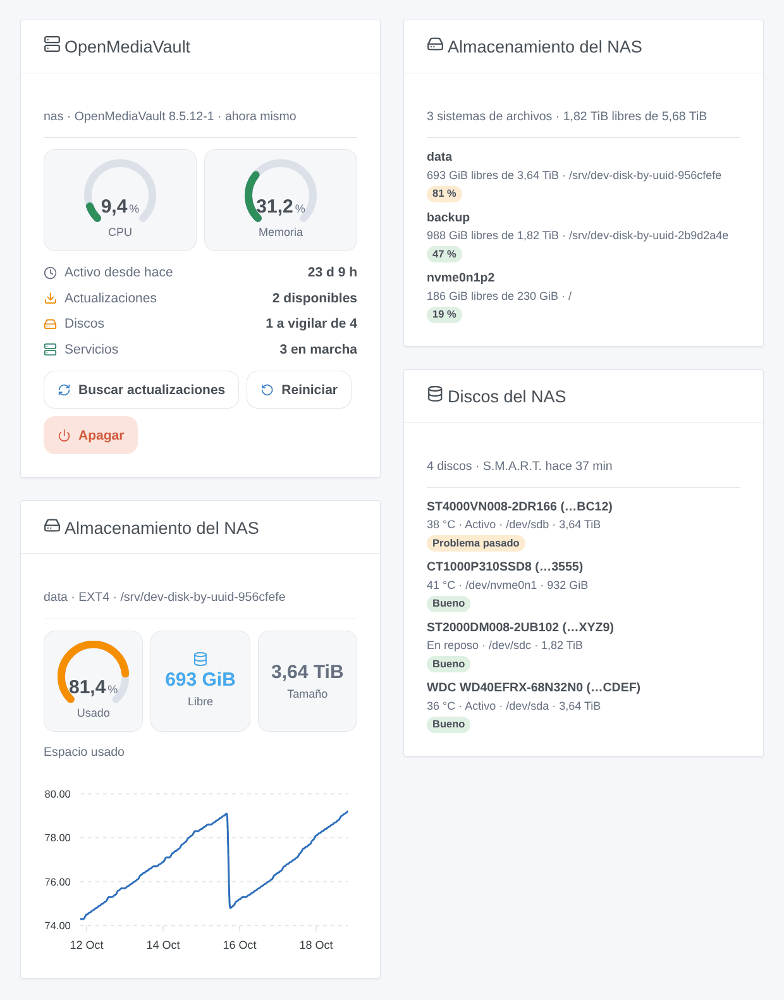

# Gladys OpenMediaVault

[English](README.md) · [Français](README.fr.md) · [Deutsch](README.de.md) · **Español**

[](LICENSE)
[](https://github.com/William-De71/gladys-openmediavault/releases)
[](https://github.com/William-De71/gladys-openmediavault/actions/workflows/release.yml)
[](https://gladysassistant.com)


Integración externa de [Gladys Assistant](https://gladysassistant.com) para el NAS **OpenMediaVault**: su CPU, memoria y actualizaciones, la temperatura, el reposo y la salud S.M.A.R.T. de sus discos, la ocupación de sus sistemas de archivos, sus servicios y tareas rsync, con escenas y widgets del panel. Todo pasa por la interfaz web de OpenMediaVault en su red local: sin nube.

Documentación de usuario: [English](docs/en.md) · [Français](docs/fr.md) · [Deutsch](docs/de.md) · [Español](docs/es.md).

> Integración comunitaria, no afiliada ni respaldada por el proyecto openmediavault.

## Funciones

- Dispositivo **NAS**: uso de CPU y memoria, tiempo activo, paquetes por actualizar, versión.
- Un dispositivo por **disco** (temperatura, reposo, salud S.M.A.R.T.), por **sistema de archivos** (espacio usado, espacio libre) y por **servicio** activado (en marcha o no).
- **Los discos en reposo nunca se despiertan** por defecto: la salud S.M.A.R.T. solo se lee cuando todos los discos giran.
- **8 disparadores de escena**, **5 acciones de escena** (tarea rsync, búsqueda de actualizaciones, reinicio, apagado…) y **3 widgets** del panel (abajo).
- Probada con un OpenMediaVault 8.5 real.
- Cuatro idiomas en todas partes: inglés, francés, alemán, español.

## Funcionamiento




Del descubrimiento a una escena:



### Transporte

`transports: ["local"]`: la integración solo habla con la interfaz web de OpenMediaVault, en su red, con las mismas llamadas RPC que su navegador. El certificado HTTPS solo se verifica si marca «Verificar el certificado HTTPS». Ningún dato sale de su red; OpenMediaVault contacta él mismo con sus repositorios de paquetes al buscar actualizaciones.

## Dispositivos y funciones

| Dispositivo         | Funciones (categoría / tipo)                                                                                            |
| ------------------- | ----------------------------------------------------------------------------------------------------------------------- |
| NAS                 | CPU, memoria (`level-sensor` %), tiempo activo (`duration`, días), actualizaciones (`counter-sensor`), versión (`text`) |
| Disco               | Temperatura (`device-temperature-sensor` °C), estado de energía y salud S.M.A.R.T. (`text`)                             |
| Sistema de archivos | Espacio usado (`level-sensor` %), espacio libre (`data` / `size`, GB)                                                   |
| Servicio            | En ejecución (`switch` / `binary`, solo lectura: una insignia Activo / Inactivo)                                        |

Los identificadores externos se basan en identificadores estables: el número de serie de un disco (si no, su WWN, nunca `/dev/sdX`), el UUID de un sistema de archivos, el nombre de un servicio. Cada función es un estado: los comandos son acciones de escena.

## Disparadores, acciones de escena y widgets



**Widgets**: OpenMediaVault (indicadores de CPU y memoria, tiempo activo, actualizaciones, discos, servicios; botones «Buscar actualizaciones», «Reiniciar» y «Apagar», estos dos con confirmación), Almacenamiento del NAS (todos los sistemas de archivos, o uno con el historial de su ocupación), Discos del NAS (temperatura, reposo, salud).

**Disparadores**: NAS inaccesible o de vuelta (dos lecturas sin respuesta), NAS reiniciado, actualizaciones disponibles, reinicio necesario, salud de un disco cambiada, sistema de archivos por encima o por debajo de su umbral de aviso (el fijado en OpenMediaVault), sistema de archivos ausente o de vuelta, servicio iniciado o detenido.

**Acciones**: leer el estado, lanzar una tarea rsync (espera hasta 100 s y devuelve `completed`, `failed` o `running`), buscar actualizaciones (`apt update`, no instala nada), reiniciar, apagar (con un retraso opcional).

Ejemplos:

- Cuando un disco empieza a fallar → enviar el resumen del evento por Telegram.
- Cada noche a las 2 → lanzar la tarea rsync «Copia de fotos»; si `status` no es `completed`, avisarme.
- Cuando la casa está vacía una semana → apagar el NAS.

Un reinicio o un apagado pedido desde Gladys no dispara ni «inaccesible» ni «reiniciado»; una búsqueda de actualizaciones lanzada por una escena nunca dispara «actualizaciones disponibles».

## Requisitos

- Gladys Assistant **5.1.0** o posterior (widgets y escenas): las instancias más antiguas no pueden instalar la integración.
- OpenMediaVault 7 u 8 (OpenMediaVault 6 sin el reposo de los discos), y una cuenta de administrador sin doble autenticación (vea la [documentación](docs/es.md#requisitos-previos)).

## Instalación

- **Desde la tienda**: Integraciones → OpenMediaVault → Instalar.
- **Desde la URL del repositorio**: Integraciones → integración externa → `https://github.com/William-De71/gladys-openmediavault`.
- **Modo desarrollador**: ejecute `npm start` con las variables que da Gladys (vea Desarrollo).

## Configuración

| Campo                          | Por defecto          | Significado                                                  |
| ------------------------------ | -------------------- | ------------------------------------------------------------ |
| Dirección de OpenMediaVault    | —                    | `http://192.168.1.10`, con el puerto si no es 80 ni 443      |
| Usuario / Contraseña           | `admin` / —          | Un administrador (la contraseña es un campo `secret`)        |
| Verificar el certificado HTTPS | desactivado          | Solo para una dirección `https://` con un certificado válido |
| Intervalo de lectura           | 60 s                 | De 15 a 240 s; los discos cada 5 min                         |
| Salud S.M.A.R.T. de los discos | ningún disco dormido | cuando ningún disco está en reposo, cada hora, nunca         |
| Idioma de los textos           | automático           | Nombres, estados y resúmenes de escena                       |

## Uso

1. Rellene la configuración y pulse **Probar la conexión**.
2. **Descubrir**, luego añada el NAS, los discos, los sistemas de archivos y los servicios que quiera.
3. Añada los widgets a un panel y cree escenas con los disparadores y las acciones.

## Desarrollo

```bash
npm install
npm test                       # node --test, nunca toca la red
npm run lint                   # ESLint
npm run format:check           # Prettier
npx github:GladysAssistant/integration-store . --skip-image-check
scripts/build-cover.sh         # cover.jpg desde docs/assets/cover.svg
docs/illustrations/render.sh   # docs/assets/widgets.<lang>.png
```

En local, el SDK lee `GLADYS_HOST_API_URL`, `GLADYS_INTEGRATION_TOKEN` y `GLADYS_INTEGRATION_SELECTOR` (que da Gladys en modo desarrollador). `DEBUG=gladys-integration-sdk` muestra los registros del SDK.

Las pruebas cubren el cliente RPC (sesiones, cookies, errores, el transporte real en un servidor local), la lectura de las respuestas (grabadas en un OpenMediaVault 8.5 real y luego anonimizadas), las transiciones, los dispositivos (los campos que exige la pantalla de descubrimiento), los widgets (`validateWidgetContent`), los eventos y salidas de escena, el manifiesto, los cuatro idiomas, el script de release, y la integración entera frente al Gladys falso del SDK y un OpenMediaVault falso. `test/structure.test.js` fija cada clave que guardan los usuarios.

## Proceso de release


Cada fusión en `main` lanza la CI y luego calcula la versión a partir de los [Conventional Commits](https://www.conventionalcommits.org/es/) desde la última etiqueta: `feat` → menor, `fix` / `perf` → parche, `!` o `BREAKING CHANGE` → mayor (una menor antes de 1.0.0); `docs`, `chore`, `ci`, `test`, `style`, `refactor`, `build` solos no publican nada. Se genera la sección del changelog, se empuja la etiqueta, se construye la imagen multiarquitectura, luego `main` recibe el commit de release, se crea la GitHub Release y un último job verifica la imagen pública, el validador de la tienda y el topic.

- El título de la pull request se convierte en el commit squash y luego en la línea del changelog: escríbalo en inglés, para el usuario (`pr-title.yml` lo comprueba). No edite nunca `CHANGELOG.md` a mano.
- La 1.0.0 es una decisión: Actions → Release → Run workflow con `release-as: 1.0.0`. `dry-run` muestra la versión y las notas sin publicar nada.
- **Rama protegida**: la release empuja su commit a `main` con `GITHUB_TOKEN`. El ruleset `protect-main` (sin borrado, sin force-push) lo deja pasar; una regla más estricta (pull request obligatoria, status checks) necesita GitHub Actions en su lista de excepciones, o una GitHub App.
- Tras la primera release, haga público el paquete `ghcr.io` (Package settings → Change visibility); si no, Gladys no puede descargarlo.

## Solución de problemas

Vea [docs/es.md](docs/es.md#solución-de-problemas). Informe de un problema con las versiones de Gladys, de la integración y de OpenMediaVault, y los registros (`DEBUG=gladys-integration-sdk`).

## Contribuir

Issues y pull requests bienvenidas. Ejecute `npm run format:check && npm run lint && npm test` antes de abrir una pull request, y no cambie ningún identificador externo ni ninguna clave guardada (vea [CLAUDE.md](CLAUDE.md)).

## Seguridad

Vea [SECURITY.md](SECURITY.md): informe de las vulnerabilidades en privado. La contraseña es un campo `secret`, nunca se registra ni se pone en una URL; solo se guarda en `/data` la cookie «navegador conocido» de OpenMediaVault, nunca la sesión. OpenMediaVault no tiene un rol de solo lectura: use una cuenta de administrador dedicada a Gladys.

## Capturas próximas

Las imágenes de arriba son ilustraciones, no capturas de pantalla. Las capturas reales irán en `docs/assets/screenshots/` (PNG, 1280 × 800): `configuration.png`, `discovery.png`, `devices.png`, `scene.png`.

## Licencia

[Licencia Apache 2.0](LICENSE) — vea también [NOTICE](NOTICE). Esta integración comunitaria no está afiliada al proyecto openmediavault. Gracias a la documentación y al SDK de Gladys, al código fuente de openmediavault y a homeassistant-openmediavault por la inspiración.
