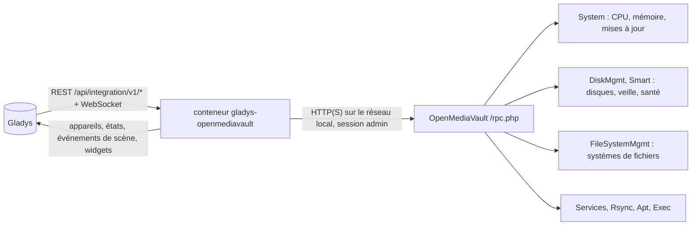
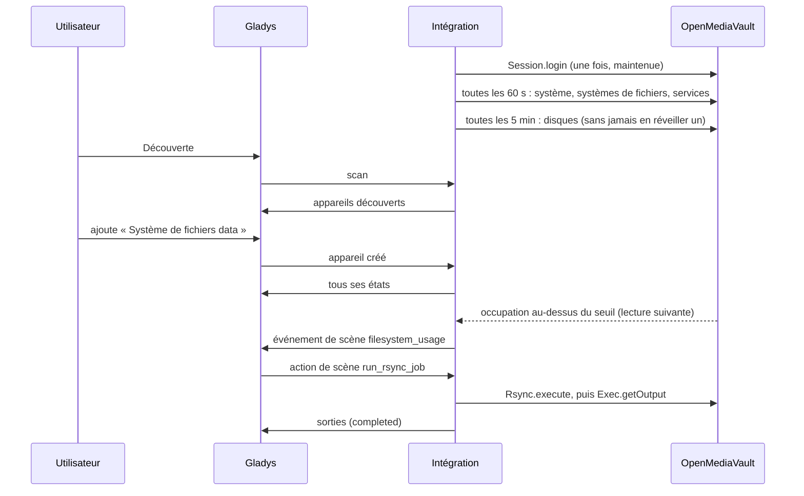
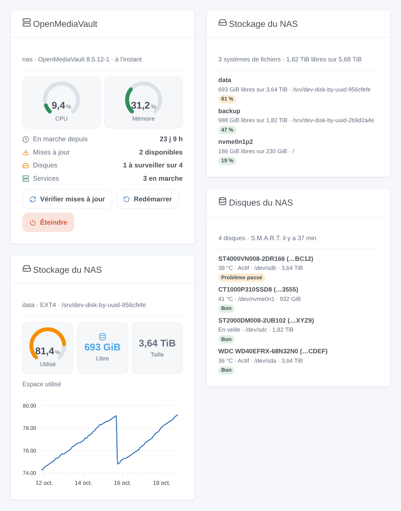

# Gladys OpenMediaVault

[English](README.md) · **Français** · [Deutsch](README.de.md) · [Español](README.es.md)

[](LICENSE)
[](https://github.com/William-De71/gladys-openmediavault/releases)
[](https://github.com/William-De71/gladys-openmediavault/actions/workflows/release.yml)
[](https://gladysassistant.com)


Intégration externe de [Gladys Assistant](https://gladysassistant.com) pour le NAS **OpenMediaVault** : son CPU, sa mémoire et ses mises à jour, la température, la mise en veille et la santé S.M.A.R.T. de ses disques, le remplissage de ses systèmes de fichiers, ses services et ses tâches rsync, avec des scènes et des widgets de tableau de bord. Tout passe par l’interface web d’OpenMediaVault sur votre réseau local : aucun cloud.

Documentation utilisateur : [English](docs/en.md) · [Français](docs/fr.md) · [Deutsch](docs/de.md) · [Español](docs/es.md).

> Intégration communautaire, ni affiliée ni approuvée par le projet openmediavault.

## Fonctionnalités

- Appareil **NAS** : utilisation du CPU et de la mémoire, durée de fonctionnement, paquets à mettre à jour, version.
- Un appareil par **disque** (température, mise en veille, santé S.M.A.R.T.), par **système de fichiers** (espace utilisé, espace libre) et par **service** activé (en marche ou non).
- **Les disques en veille ne sont jamais réveillés** par défaut : la santé S.M.A.R.T. n’est lue que quand tous les disques tournent.
- **8 déclencheurs de scène**, **5 actions de scène** (tâche rsync, recherche de mises à jour, redémarrage, arrêt…) et **3 widgets** de tableau de bord (ci-dessous).
- Testée sur un vrai OpenMediaVault 8.5.
- Quatre langues partout : anglais, français, allemand, espagnol.

## Fonctionnement




De la découverte à une scène :



### Transport

`transports: ["local"]` : l’intégration ne parle qu’à l’interface web d’OpenMediaVault, sur votre réseau, avec les mêmes appels RPC que votre navigateur. Le certificat HTTPS n’est vérifié que si vous cochez « Vérifier le certificat HTTPS ». Aucune donnée ne quitte votre réseau ; OpenMediaVault contacte lui-même ses dépôts de paquets lors d’une recherche de mises à jour.

## Appareils et fonctionnalités

| Appareil            | Fonctionnalités (catégorie / type)                                                                                              |
| ------------------- | ------------------------------------------------------------------------------------------------------------------------------- |
| NAS                 | CPU, mémoire (`level-sensor` %), durée de fonctionnement (`duration`, jours), mises à jour (`counter-sensor`), version (`text`) |
| Disque              | Température (`device-temperature-sensor` °C), état d’alimentation et santé S.M.A.R.T. (`text`)                                  |
| Système de fichiers | Espace utilisé (`level-sensor` %), espace libre (`data` / `size`, Go)                                                           |
| Service             | En marche (`switch` / `binary`, en lecture seule : un badge Actif / Inactif)                                                    |

Les identifiants externes reposent sur des identifiants stables : le numéro de série d’un disque (sinon son WWN, jamais `/dev/sdX`), l’UUID d’un système de fichiers, le nom d’un service. Chaque fonctionnalité est un état : les commandes sont des actions de scène.

## Déclencheurs, actions de scène et widgets



**Widgets** : OpenMediaVault (jauges CPU et mémoire, durée de fonctionnement, mises à jour, disques, services ; boutons « Vérifier mises à jour », « Redémarrer » et « Éteindre », ces deux derniers avec confirmation), Stockage du NAS (tous les systèmes de fichiers, ou l’un d’eux avec l’historique de son occupation), Disques du NAS (température, veille, santé).

**Déclencheurs** : NAS injoignable ou de retour (deux lectures sans réponse), NAS redémarré, mises à jour disponibles, redémarrage nécessaire, santé d’un disque changée, système de fichiers au-dessus ou en dessous de son seuil d’alerte (celui réglé dans OpenMediaVault), système de fichiers absent ou revenu, service démarré ou arrêté.

**Actions** : lire l’état, lancer une tâche rsync (attend jusqu’à 100 s et renvoie `completed`, `failed` ou `running`), chercher les mises à jour (`apt update`, n’installe rien), redémarrer, éteindre (avec un délai facultatif).

Exemples :

- Quand un disque devient défaillant → envoyer le résumé de l’événement sur Telegram.
- Chaque nuit à 2 h → lancer la tâche rsync « Sauvegarde photos » ; si `status` n’est pas `completed`, me prévenir.
- Quand la maison est vide depuis une semaine → éteindre le NAS.

Un redémarrage ou un arrêt demandé par Gladys ne déclenche ni « injoignable » ni « redémarré » ; une recherche de mises à jour lancée par une scène ne déclenche jamais « mises à jour disponibles ».

## Prérequis

- Gladys Assistant **5.3.0** ou plus récent (widgets et scènes, mots-clés du catalogue de Gladys 5.3) : les instances plus anciennes ne peuvent pas installer l’intégration.
- OpenMediaVault 7 ou 8 (OpenMediaVault 6 sans la mise en veille des disques), et un compte administrateur sans double authentification (voir la [documentation](docs/fr.md#prérequis)).

## Installation

- **Depuis le store** : Intégrations → OpenMediaVault → Installer.
- **Depuis l’URL du dépôt** : Intégrations → intégration externe → `https://github.com/William-De71/gladys-openmediavault`.
- **Mode développeur** : lancez `npm start` avec les variables fournies par Gladys (voir Développement).

## Configuration

| Champ                        | Défaut                 | Signification                                                   |
| ---------------------------- | ---------------------- | --------------------------------------------------------------- |
| Adresse d’OpenMediaVault     | —                      | `http://192.168.1.10`, avec le port s’il n’est pas 80 ou 443    |
| Utilisateur / Mot de passe   | `admin` / —            | Un administrateur (le mot de passe est un champ `secret`)       |
| Vérifier le certificat HTTPS | désactivé              | Seulement pour une adresse `https://` avec un certificat valide |
| Intervalle de lecture        | 60 s                   | 15 à 240 s ; les disques toutes les 5 min                       |
| Santé S.M.A.R.T. des disques | aucun disque en veille | quand aucun disque n’est en veille, chaque heure, jamais        |
| Langue des textes            | automatique            | Noms, états et résumés de scène                                 |

## Utilisation

1. Remplissez la configuration, puis cliquez sur **Tester la connexion**.
2. **Découverte**, puis ajoutez le NAS, les disques, les systèmes de fichiers et les services voulus.
3. Ajoutez les widgets à un tableau de bord, et construisez des scènes avec les déclencheurs et les actions.

## Développement

```bash
npm install
npm test                       # node --test, ne touche jamais le réseau
npm run lint                   # ESLint
npm run format:check           # Prettier
npx github:GladysAssistant/integration-store . --skip-image-check
scripts/build-cover.sh         # cover.jpg depuis docs/assets/cover.svg
docs/illustrations/render.sh   # docs/assets/widgets.<lang>.png
```

En local, le SDK lit `GLADYS_HOST_API_URL`, `GLADYS_INTEGRATION_TOKEN` et `GLADYS_INTEGRATION_SELECTOR` (fournis par Gladys en mode développeur). `DEBUG=gladys-integration-sdk` affiche les journaux du SDK.

Les tests couvrent le client RPC (sessions, cookies, erreurs, le vrai transport sur un serveur local), la lecture des réponses (enregistrées sur un vrai OpenMediaVault 8.5, puis anonymisées), les transitions, les appareils (les champs qu’exige l’écran de découverte), les widgets (`validateWidgetContent`), les événements et sorties de scène, le manifeste, les quatre langues, le script de release, et l’intégration entière face au faux Gladys du SDK et à un faux OpenMediaVault. `test/structure.test.js` fige chaque clé stockée chez les utilisateurs.

## Processus de release


Chaque fusion sur `main` lance la CI, puis calcule la version depuis les [Conventional Commits](https://www.conventionalcommits.org/fr/) depuis le dernier tag : `feat` → mineure, `fix` / `perf` → correctif, `!` ou `BREAKING CHANGE` → majeure (une mineure avant 1.0.0) ; `docs`, `chore`, `ci`, `test`, `style`, `refactor`, `build` seuls ne publient rien. La section du changelog est générée, le tag poussé, l’image multi-architecture construite, puis `main` reçoit le commit de release, la GitHub Release est créée et un dernier job vérifie l’image publique, le validateur du store et le topic.

- Le titre de la pull request devient le commit squash, puis la ligne du changelog : écrivez-le en anglais, pour l’utilisateur (`pr-title.yml` le vérifie). Ne modifiez jamais `CHANGELOG.md` à la main.
- La 1.0.0 est une décision : Actions → Release → Run workflow avec `release-as: 1.0.0`. `dry-run` montre la version et les notes sans rien publier.
- **Branche protégée** : la release pousse son commit sur `main` avec `GITHUB_TOKEN`. Le ruleset `protect-main` (ni suppression, ni force-push) le laisse passer ; une règle plus stricte (pull request obligatoire, status checks) demande d’ajouter GitHub Actions à sa liste de contournement, ou une GitHub App.
- Après la première release, rendez public le package `ghcr.io` (Package settings → Change visibility), sinon Gladys ne peut pas le télécharger.

## Dépannage

Voir [docs/fr.md](docs/fr.md#dépannage). Signalez un problème avec les versions de Gladys, de l’intégration et d’OpenMediaVault, et les journaux (`DEBUG=gladys-integration-sdk`).

## Contribuer

Issues et pull requests bienvenues. Lancez `npm run format:check && npm run lint && npm test` avant d’ouvrir une pull request, et gardez inchangés chaque identifiant externe et chaque clé stockée (voir [CLAUDE.md](CLAUDE.md)).

## Sécurité

Voir [SECURITY.md](SECURITY.md) : signalez les vulnérabilités en privé. Le mot de passe est un champ `secret`, jamais journalisé ni placé dans une URL ; seul le cookie « navigateur connu » d’OpenMediaVault est gardé dans `/data`, jamais la session. OpenMediaVault n’a pas de rôle en lecture seule : utilisez un compte administrateur dédié à Gladys.

## Captures à venir

Les images ci-dessus sont des illustrations, pas des captures d’écran. Les vraies captures iront dans `docs/assets/screenshots/` (PNG, 1280 × 800) : `configuration.png`, `discovery.png`, `devices.png`, `scene.png`.

## Licence

[Licence Apache 2.0](LICENSE) — voir aussi [NOTICE](NOTICE). Cette intégration communautaire n’est pas affiliée au projet openmediavault. Merci à la documentation et au SDK de Gladys, au code source d’openmediavault, et à homeassistant-openmediavault pour l’inspiration.
