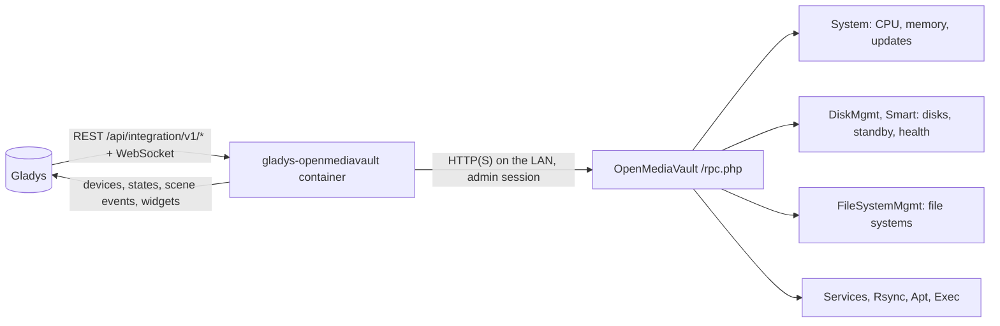
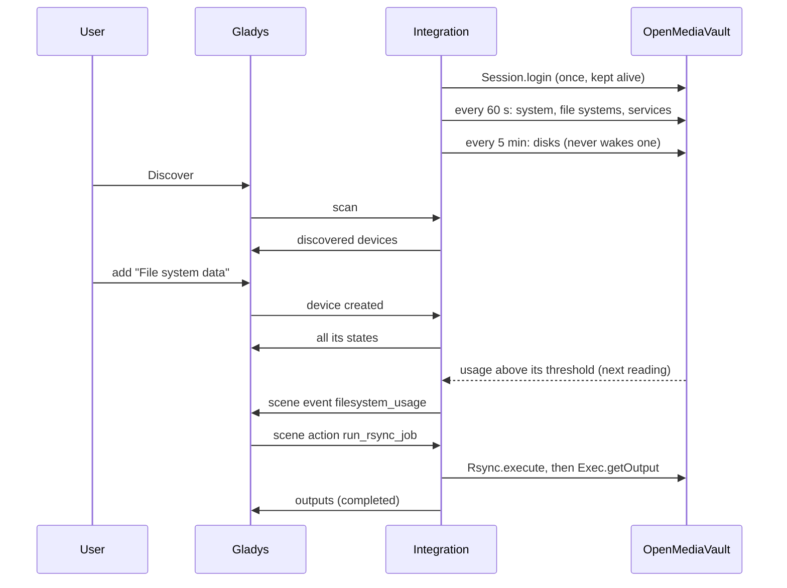
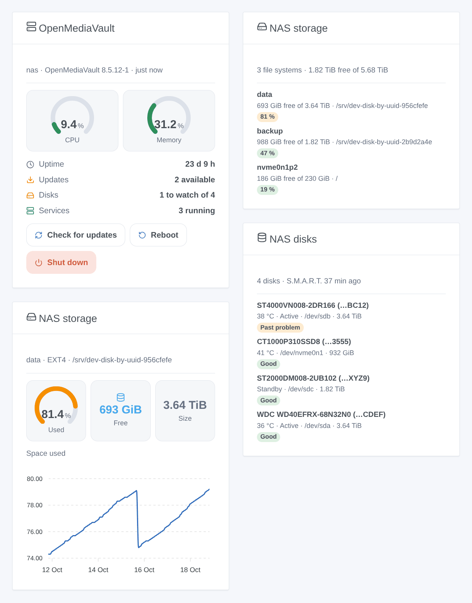

# Gladys OpenMediaVault

**English** · [Français](README.fr.md) · [Deutsch](README.de.md) · [Español](README.es.md)

[](LICENSE)
[](https://github.com/William-De71/gladys-openmediavault/releases)
[](https://github.com/William-De71/gladys-openmediavault/actions/workflows/release.yml)
[](https://gladysassistant.com)


[Gladys Assistant](https://gladysassistant.com) external integration for the **OpenMediaVault** NAS: its CPU, memory and updates, the temperature, standby and S.M.A.R.T. health of its disks, how full its file systems are, its services and rsync jobs, with scenes and dashboard widgets. Everything goes through the web interface of OpenMediaVault on your local network: no cloud.

User documentation: [English](docs/en.md) · [Français](docs/fr.md) · [Deutsch](docs/de.md) · [Español](docs/es.md).

> Community integration, not affiliated with nor endorsed by the openmediavault project.

## Features

- **NAS** device: CPU and memory usage, uptime, packages to upgrade, version.
- A device per **disk** (temperature, standby, S.M.A.R.T. health), per **file system** (space used, free space) and per enabled **service** (running or not).
- **Disks in standby are never woken up** by default: the S.M.A.R.T. health is read only while every disk spins.
- **8 scene triggers**, **5 scene actions** (rsync job, update check, reboot, shutdown…) and **3 dashboard widgets** (below).
- Tested against a real OpenMediaVault 8.5.
- Four languages everywhere: English, French, German, Spanish.

## How it works




From the scan to a scene:



### Transport

`transports: ["local"]`: the integration only talks to the web interface of OpenMediaVault, on your network, with the same RPC calls as your browser. The HTTPS certificate is checked only when you tick "Check the HTTPS certificate". No data leaves your network; OpenMediaVault itself contacts its package mirrors during an update check.

## Devices and features

| Device      | Features (category / type)                                                                              |
| ----------- | ------------------------------------------------------------------------------------------------------- |
| NAS         | CPU, memory (`level-sensor` %), uptime (`duration`, days), updates (`counter-sensor`), version (`text`) |
| Disk        | Temperature (`device-temperature-sensor` °C), power state and S.M.A.R.T. health (`text`)                |
| File system | Space used (`level-sensor` %), free space (`data` / `size`, GB)                                         |
| Service     | Running (`switch` / `binary`, read-only: an Active / Inactive badge)                                    |

External ids rest on stable identifiers: the serial number of a disk (else its WWN, never `/dev/sdX`), the UUID of a file system, the name of a service. Every feature is a state: the commands are scene actions.

## Scene triggers, actions and widgets



**Widgets**: OpenMediaVault (CPU and memory gauges, uptime, updates, disks, services; "check for updates", "reboot" and "shut down" buttons, the last two with a confirmation), NAS storage (every file system, or one with the history of its usage), NAS disks (temperature, standby, health).

**Triggers**: NAS unreachable or back (two readings without answer), NAS restarted, updates available, reboot required, disk health changed, file system above or below its warning threshold (the one set in OpenMediaVault), file system missing or back, service started or stopped.

**Actions**: read the status, run an rsync job (waits up to 100 s and returns `completed`, `failed` or `running`), check for updates (`apt update`, installs nothing), reboot, shut down (with an optional delay).

Examples:

- When a disk becomes failing → send the summary of the event by Telegram.
- Every night at 2 am → run the rsync job "Photos backup"; if `status` is not `completed`, notify me.
- When the house is empty for a week → shut down the NAS.

A reboot or a shutdown asked from Gladys fires neither "unreachable" nor "restarted"; an update check run by a scene never fires "updates available".

## Requirements

- Gladys Assistant **5.1.0** or later (widgets and scenes): older instances cannot install the integration.
- OpenMediaVault 7 or 8 (OpenMediaVault 6 without the standby of the disks), and an administrator account without two-factor authentication (see the [documentation](docs/en.md#prerequisites)).

## Installation

- **From the store**: Integrations → OpenMediaVault → Install.
- **From the repository URL**: Integrations → external integration → `https://github.com/William-De71/gladys-openmediavault`.
- **Developer mode**: run `npm start` with the variables given by Gladys (see Development).

## Configuration

| Field                          | Default        | Meaning                                                     |
| ------------------------------ | -------------- | ----------------------------------------------------------- |
| Address of OpenMediaVault      | —              | `http://192.168.1.10`, with the port if it is not 80 or 443 |
| User / Password                | `admin` / —    | An administrator (the password is a `secret` field)         |
| Check the HTTPS certificate    | off            | Only for an `https://` address with a valid certificate     |
| Reading interval               | 60 s           | 15 to 240 s; the disks every 5 min                          |
| S.M.A.R.T. health of the disks | no disk asleep | when no disk is in standby, every hour, never               |
| Language of the texts          | automatic      | Names, states and scene summaries                           |

## Usage

1. Fill in the configuration, then click **Test the connection**.
2. **Discover**, then add the NAS, the disks, the file systems and the services you want.
3. Add the widgets to a dashboard, and build scenes with the triggers and actions.

## Development

```bash
npm install
npm test                       # node --test, never touches the network
npm run lint                   # ESLint
npm run format:check           # Prettier
npx github:GladysAssistant/integration-store . --skip-image-check
scripts/build-cover.sh         # cover.jpg from docs/assets/cover.svg
docs/illustrations/render.sh   # docs/assets/widgets.<lang>.png
```

Locally, the SDK reads `GLADYS_HOST_API_URL`, `GLADYS_INTEGRATION_TOKEN` and `GLADYS_INTEGRATION_SELECTOR` (given by Gladys in developer mode). `DEBUG=gladys-integration-sdk` shows the SDK logs.

The tests cover the RPC client (sessions, cookies, errors, the real transport on a local server), the reading of the answers (recorded on a real OpenMediaVault 8.5, then anonymized), the transitions, the devices (the fields the Discovery screen requires), the widgets (`validateWidgetContent`), the scene events and outputs, the manifest, the four languages, the release script, and the whole integration against the fake Gladys of the SDK and a fake OpenMediaVault. `test/structure.test.js` freezes every key users store.

## Release process


Every merge on `main` runs the CI, then computes the version from the [Conventional Commits](https://www.conventionalcommits.org/) since the last tag: `feat` → minor, `fix` / `perf` → patch, `!` or `BREAKING CHANGE` → major (a minor below 1.0.0); `docs`, `chore`, `ci`, `test`, `style`, `refactor`, `build` alone publish nothing. The changelog section is generated, the tag pushed, the multi-architecture image built, then `main` receives the release commit, the GitHub Release is created and a last job checks the public image, the store validator and the topic.

- The pull request title becomes the squash commit, then the changelog line: write it in English, for the user (`pr-title.yml` checks it). Never edit `CHANGELOG.md` by hand.
- 1.0.0 is a decision: Actions → Release → Run workflow with `release-as: 1.0.0`. `dry-run` shows the version and the notes without publishing.
- **Protected branch**: the release pushes its commit to `main` with `GITHUB_TOKEN`. The `protect-main` ruleset (no deletion, no force-push) lets it through; a stricter rule (required pull request, status checks) needs GitHub Actions in its bypass list, or a GitHub App.
- After the first release, make the `ghcr.io` package public (Package settings → Change visibility), or Gladys cannot pull it.

## Troubleshooting

See [docs/en.md](docs/en.md#troubleshooting). Report issues with the versions of Gladys, of the integration and of OpenMediaVault, and the logs (`DEBUG=gladys-integration-sdk`).

## Contributing

Issues and pull requests are welcome. Run `npm run format:check && npm run lint && npm test` before opening a pull request, and keep every external id and stored key unchanged (see [CLAUDE.md](CLAUDE.md)).

## Security

See [SECURITY.md](SECURITY.md): report vulnerabilities privately. The password is a `secret` field, never logged nor put in an URL; only the "known browser" cookie of OpenMediaVault is kept in `/data`, never the session. OpenMediaVault has no read-only role: use a dedicated administrator account for Gladys.

## Screenshots to come

The images above are illustrations, not screenshots. Real screenshots will go in `docs/assets/screenshots/` (PNG, 1280 × 800): `configuration.png`, `discovery.png`, `devices.png`, `scene.png`.

## License

[Apache License 2.0](LICENSE) — see also [NOTICE](NOTICE). This community integration is not affiliated with the openmediavault project. Thanks to the Gladys documentation and SDK, to the source of openmediavault, and to homeassistant-openmediavault for the inspiration.
